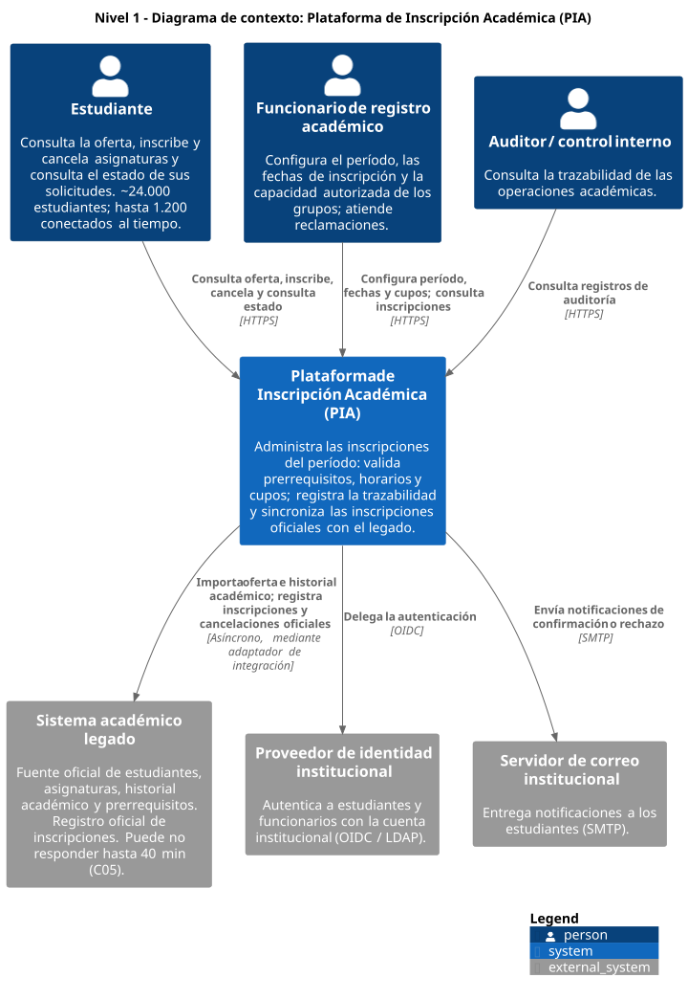
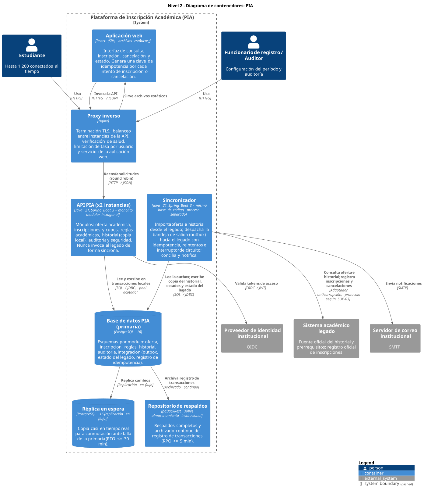
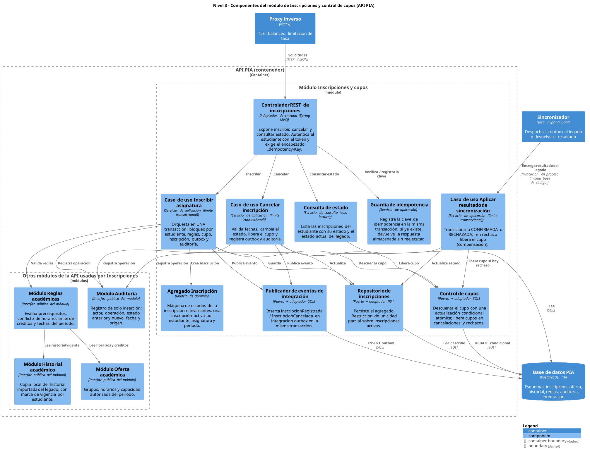

**Estudiante:** Camilo Andrés López Hernández — **Documento:** 1233691138

# Actividad 2. Diseño de la estructura arquitectónica

La estructura que se propone responde a los drivers priorizados en la [Actividad 1](actividad1.md), en este orden:

1. QAS-02, integridad de cupos.
2. QAS-01, disponibilidad ante la falla del legado (Escenario A).
3. QAS-03, no duplicación.
4. QAS-04, rendimiento de consultas.
5. QAS-05, recuperabilidad.
6. QAS-06, seguridad y trazabilidad.
7. QAS-07, modificabilidad.

También responde a las restricciones RES-01 a RES-04.

Los diagramas siguen el modelo C4 (Brown, 2018). Sus fuentes están en texto PlantUML (`.puml`), versionadas en [docs/diagramas/](diagramas/), y cada una se exporta en SVG (vectorial) y en PNG.

---

## 1. Selección del estilo arquitectónico

### 1.1 Alternativas consideradas

| Alternativa | Descripción |
|---|---|
| A1. Monolito en capas | Una sola aplicación organizada en capas horizontales: presentación, negocio y datos. Cada capa solo usa a la inferior (Buschmann et al., 1996). |
| A2. Monolito modular con arquitectura hexagonal | Una sola base de código dividida en módulos verticales por subdominio (oferta, inscripciones, reglas, historial, auditoría, integración). Dentro de cada módulo, el dominio queda en el centro y se comunica con el exterior solo mediante puertos (interfaces) y adaptadores (Cockburn, 2005). Los módulos solo se comunican a través de sus interfaces públicas (Parnas, 1972). |
| A3. Microservicios | Servicios desplegables por separado, cada uno con su propia base de datos, comunicados por red (Lewis y Fowler, 2014). |

La arquitectura limpia (Martin, 2017) se consideró una variante de A2: comparte la regla de que las dependencias apuntan hacia el dominio. Se prefirió la formulación hexagonal porque el problema central de PIA es aislar al dominio de sistemas externos que fallan, como el legado y el proveedor de identidad, y el concepto de puerto y adaptador modela eso directamente con menos capas que mantener.

### 1.2 Comparación según los drivers

Escala: ++ favorece claramente, + favorece, 0 neutro, − perjudica, −− perjudica claramente.

| Criterio (driver) | A1. Capas | A2. Modular + hexagonal | A3. Microservicios |
|---|---|---|---|
| QAS-02 Integridad de cupos: transacción local sobre cupo, inscripción y auditoría | ++ Una base de datos y una transacción. | ++ Una base de datos y una transacción. | −− El cupo y la inscripción quedan en servicios distintos; hace falta coordinación distribuida (sagas o dos fases). |
| QAS-01 Aislamiento de la falla del legado | − La integración queda mezclada con la lógica de negocio. | ++ El legado queda detrás de un puerto; se puede sacar a un proceso aparte sin cambiar el dominio. | + Se aísla en un servicio, pero sumando otros puntos de falla de red. |
| QAS-04 Rendimiento | + Llamadas en memoria. | + Llamadas en memoria entre módulos. | − Cada consulta atraviesa varios saltos de red (Deutsch, 1994). |
| QAS-07 Modificabilidad de reglas | − Las reglas se dispersan en la capa de negocio. | ++ Las reglas son un módulo con un puerto propio. | + Aisladas, pero cada cambio puede afectar contratos entre servicios. |
| RES-02 Operable por 4 desarrolladores y 1 administrador | ++ Un despliegue. | + Dos procesos de la misma base de código. | −− Muchos despliegues, bases de datos, monitoreo distribuido y probablemente un orquestador. |
| RES-01 Linux, PostgreSQL y sin servicios comerciales | ++ | ++ | − En la práctica requiere broker, descubrimiento de servicios y orquestación que habría que operar en infraestructura propia. |
| Gobernanza: reglas de dependencia verificables automáticamente | − Solo se controla la dirección entre capas. | ++ Reglas de módulo y de hexágono verificables con pruebas de arquitectura (ver Actividad 5). | + Los límites los fija la red, pero el contrato entre servicios exige otra gobernanza. |

### 1.3 Decisión

**Se selecciona A2: un monolito modular con arquitectura hexagonal en cada módulo, desplegado en dos procesos de la misma base de código.**
- Un proceso **API**, en dos instancias, atiende a los usuarios.
- Un proceso **Sincronizador** ejecuta la integración con el legado.

Justificación:
1. **El driver de mayor prioridad, QAS-02, exige atomicidad local.** El cupo, la inscripción, el registro de idempotencia, el evento de sincronización y la auditoría se confirman o anulan juntos en una sola transacción de PostgreSQL (Haerder y Reuter, 1983). Ninguna alternativa distribuida da esa garantía con menor costo.
2. **El segundo driver, QAS-01, exige que ninguna operación de usuario dependa de forma síncrona del legado** (Actividad 1, sección 4.1). Con los puertos y adaptadores, el legado solo se toca desde el adaptador del Sincronizador. Ejecutarlo en un proceso aparte impide que sus esperas, reintentos o caídas consuman hilos o conexiones de la API.
3. **Es lo que el equipo puede operar (RES-02).** Se despliegan dos procesos de una misma base de código más PostgreSQL, sin brokers ni orquestadores. Esto también respeta la ley de Conway (Conway, 1968): un solo equipo pequeño mantiene un solo producto.
4. **Las fronteras de módulo dan la modificabilidad de QAS-07 sin pagar el costo de la red.** Esas fronteras se hacen cumplir con pruebas automáticas de arquitectura (Actividad 5).

La decisión se documenta formalmente en el ADR-001 ([Actividad 3](actividad3/)).

### 1.4 Tecnologías propuestas

Todas son de código abierto y se ejecutan sobre Linux (RES-01).

| Elemento | Tecnología | Justificación |
|---|---|---|
| API y Sincronizador | Java 21 (LTS) con Spring Boot 3 | Soporte de largo plazo, gestión transaccional declarativa sobre PostgreSQL y bibliotecas maduras para los mecanismos que exigen los drivers: Resilience4j (interruptor de circuito, tiempos de espera), Flyway (migraciones) y ArchUnit (pruebas de arquitectura). Habría que revisarla si la experiencia del equipo institucional está en otro ecosistema. |
| Interfaz web | Aplicación de una sola página (React) servida como archivos estáticos | No necesita servidor de aplicaciones propio y se puede almacenar en caché. |
| Proxy inverso y balanceo de carga | Nginx | Terminación TLS, balanceo entre las instancias de la API, limitación de tasa y servicio de archivos estáticos con un solo componente. |
| Base de datos | PostgreSQL 16 con réplica en espera (replicación en flujo) y archivado del registro de transacciones con pgBackRest | Ya es parte de la infraestructura (C08). La réplica y el archivado continuo cubren el RTO de 30 minutos y el RPO de 5 minutos (QAS-05). |
| Autenticación | Proveedor de identidad institucional mediante OpenID Connect | Reutiliza la cuenta institucional y evita almacenar credenciales en PIA (QAS-06). |

---

## 2. Nivel 1: diagrama de contexto

Fuente: [c4-nivel1-contexto.puml](diagramas/c4-nivel1-contexto.puml) · [PNG](diagramas/c4-nivel1-contexto.png)

### 2.1 Actores

| Actor | Interés en PIA | Driver relacionado |
|---|---|---|
| Estudiante | Consultar la oferta, inscribir y cancelar asignaturas, y conocer el estado real de sus solicitudes, incluso durante una falla del legado. | QAS-01, QAS-02, QAS-03, QAS-04 |
| Funcionario de registro académico | Configurar el período, las fechas de inscripción y la capacidad autorizada de los grupos; atender reclamaciones. | QAS-02, QAS-06 |
| Auditor o control interno | Reconstruir quién hizo qué operación y cuándo. | QAS-06 |

### 2.2 Sistemas externos

| Sistema | Relación con PIA | Por qué queda fuera del límite de PIA |
|---|---|---|
| Sistema académico legado | Le entrega a PIA la oferta del período y el historial académico, y recibe de PIA las inscripciones y cancelaciones para su registro oficial. | La restricción RES-03 lo mantiene como fuente oficial; PIA no lo reemplaza ni es dueño de sus datos. Su disponibilidad no depende de PIA (C05). |
| Proveedor de identidad institucional | Autentica a los usuarios. | Ya existe en la universidad; reutilizarlo cumple RES-01 y QAS-06 sin gestionar credenciales propias. |
| Servidor de correo institucional | Entrega notificaciones de confirmación o rechazo. | Servicio institucional existente. |

### 2.3 Decisión de frontera más relevante

El legado queda **fuera** del sistema y la relación con él es **asíncrona**. Las operaciones de usuario nunca esperan una respuesta del legado. El Sincronizador intercambia datos con él en segundo plano, que es la condición necesaria para cumplir QAS-01.

---

## 3. Nivel 2: diagrama de contenedores

Fuente: [c4-nivel2-contenedores.puml](diagramas/c4-nivel2-contenedores.puml) · [PNG](diagramas/c4-nivel2-contenedores.png)

### 3.1 Responsabilidades y justificación de cada contenedor

| Contenedor | Responsabilidad | Driver que justifica su existencia | Qué pasaría sin él |
|---|---|---|---|
| Aplicación web (SPA) | Presentar la oferta, capturar inscripciones y cancelaciones, mostrar el estado real de cada solicitud (*pendiente de sincronización*, *confirmada*, *rechazada*). Genera una **clave de idempotencia** (UUID) por intento y la reenvía sin cambios en los reintentos. | QAS-03, QAS-01 (informar al estudiante) | Los reintentos del navegador no se distinguirían de solicitudes nuevas. |
| Proxy inverso (Nginx) | Terminación TLS; balanceo entre las dos instancias de la API con verificación de salud; **limitación de tasa** por usuario y global; servicio de archivos estáticos. | QAS-04, DQ-01 (falla de una instancia), QAS-06 (TLS) | Una instancia caída dejaría a los usuarios sin servicio, y un pico de reintentos llegaría sin control a la base de datos. |
| API PIA (2 instancias) | Ejecuta todos los casos de uso de usuario: consulta, inscripción, cancelación, estado, configuración y auditoría. Es **sin estado**: la sesión viaja en el token, por lo que cualquier instancia atiende cualquier solicitud. **Nunca llama al legado**: usa la copia local del historial y deja los eventos de sincronización en la bandeja de salida. | QAS-02, QAS-04, QAS-07 y, sobre todo, QAS-01 | — (es el núcleo). Con una sola instancia, cada despliegue o falla consumiría el presupuesto de C03. |
| Sincronizador | Único contenedor que se comunica con el legado: (a) importa la oferta del período y la copia del historial antes de la apertura y la refresca de forma incremental; (b) despacha la bandeja de salida hacia el legado con idempotencia, reintentos con espera exponencial e interruptor de circuito; (c) actualiza el estado de cada inscripción (*confirmada* o *rechazada*) y la compensación del cupo; (d) concilia y envía notificaciones. | QAS-01, QAS-03, RES-03 | Si esta lógica viviera en la API, las esperas y reintentos contra un legado caído consumirían hilos y conexiones de la API y degradarían a todos los usuarios. |
| Base de datos PIA (PostgreSQL) | Almacena oferta, cupos, inscripciones, copia del historial, reglas, auditoría y tablas de integración. Es el **único punto de consistencia fuerte**: las restricciones de unicidad y de capacidad se declaran aquí. | QAS-02, QAS-03, QAS-06, RES-01 | — (fuente de la verdad del período). |
| Réplica en espera | Recibe los cambios de la primaria en tiempo casi real y se promueve si la primaria falla. | QAS-05 (RTO ≤ 30 min) | Una falla de la primaria obligaría a restaurar desde respaldo, lo que tarda más. |
| Repositorio de respaldos (pgBackRest) | Respaldos completos y archivado continuo del registro de transacciones, con `archive_timeout` ≤ 60 s. | QAS-05 (RPO ≤ 5 min), protección ante corrupción lógica que la réplica también copiaría. | Ante un borrado o corrupción replicados no habría punto de recuperación. |

No se incluyen un broker de mensajería, una caché distribuida ni un orquestador de contenedores. La bandeja de salida en PostgreSQL y la caché en memoria de cada instancia cubren los drivers sin agregar componentes que el equipo de RES-02 tendría que operar (ver CF-03 en la Actividad 1).

### 3.2 Mecanismos de comunicación

| Origen → destino | Mecanismo | Tipo | Justificación |
|---|---|---|---|
| Navegador → Proxy → API | HTTPS, REST con JSON. Encabezado `Idempotency-Key` en las operaciones de inscripción y cancelación. | Síncrono | Las consultas necesitan respuesta inmediata (QAS-04). La clave hace seguras las repeticiones (QAS-03). |
| API → Proveedor de identidad | OpenID Connect; la API valida localmente la firma del token (JWT) con las claves públicas del proveedor, que guarda en caché. | Síncrono solo al iniciar sesión | Validar localmente evita que una lentitud del proveedor afecte cada solicitud. |
| API → PostgreSQL | SQL por JDBC con un pool de conexiones acotado (por ejemplo, 30 por instancia). | Síncrono, transacción local | El pool acotado protege a la base de datos en los picos: las solicitudes que no consiguen conexión esperan un tiempo máximo y fallan rápido en lugar de saturarla. |
| Módulo → módulo (dentro de la API) | Llamadas en memoria a través de las interfaces públicas (puertos) de cada módulo. Ningún módulo accede a las tablas de otro. | Síncrono, en proceso | Fronteras verificables sin costo de red (QAS-07, QAS-04). |
| API → Sincronizador | **No hay llamada directa.** La API escribe eventos en la tabla `integracion.outbox` dentro de la misma transacción de negocio; el Sincronizador los lee. El Sincronizador publica el estado del legado en `integracion.estado_legado`, que la API consulta para informar al estudiante. | Asíncrono, a través de la base de datos | Patrón de bandeja de salida transaccional (Richardson, 2018): elimina la escritura dual y no exige un broker (RES-01, RES-02). |
| Sincronizador → Legado | Adaptador anticorrupción (Evans, 2003) que traduce el modelo de PIA al del legado. El protocolo concreto (servicio web, acceso a base de datos o archivos) depende de SUP-03 y queda encapsulado en el adaptador. Tiempo máximo de espera de 5 s, interruptor de circuito y reintentos con espera exponencial y variación aleatoria. | Asíncrono respecto del usuario | Aísla a PIA de la forma y la disponibilidad del legado (QAS-01). |
| Sincronizador → Correo | SMTP | Asíncrono | Las notificaciones no bloquean ninguna operación. |
| PostgreSQL → Réplica y respaldos | Replicación en flujo y archivado continuo del registro de transacciones | Asíncrono | QAS-05. |

### 3.3 Cómo responde la estructura al Escenario A

Durante los 40 minutos sin legado:
1. El interruptor de circuito del Sincronizador se abre tras 5 fallas seguidas o 30 s sin respuesta. El Sincronizador escribe `estado_legado = NO_DISPONIBLE` y deja de intentar enviar, salvo una prueba periódica cada 30 s.
2. La API **no cambia su funcionamiento**: sigue validando contra la copia local del historial, descontando cupos en PostgreSQL y dejando eventos en la bandeja de salida. Como lee `estado_legado`, informa al estudiante: "Tu inscripción está registrada y reservada; será oficial cuando se sincronice con el sistema académico".
3. Solo se restringen las inscripciones de estudiantes cuya copia del historial está marcada como no vigente (SUP-02). Se rechazan con un mensaje explícito y sin consumir cupo.
4. Cuando el legado responde a la prueba, el interruptor se cierra y el Sincronizador vacía la bandeja de salida en orden de llegada, con un ritmo limitado para no saturar al legado recién recuperado.

---

## 4. Nivel 3: componentes del módulo de Inscripciones y control de cupos

Fuente: [c4-nivel3-componentes-inscripciones.puml](diagramas/c4-nivel3-componentes-inscripciones.puml) · [PNG](diagramas/c4-nivel3-componentes-inscripciones.png)

### 4.1 Organización hexagonal del módulo

El módulo se organiza en tres anillos (Cockburn, 2005):

- **Dominio:** el agregado Inscripción con su máquina de estados e invariantes. No depende de Spring, de SQL ni de ningún otro módulo.
- **Aplicación:** los casos de uso, que definen los límites transaccionales y declaran los **puertos** que necesitan: control de cupos, repositorio, publicador de eventos, reglas, historial y auditoría.
- **Adaptadores:** el controlador REST (entrada) y las implementaciones SQL o JPA de los puertos (salida).

Así, cambiar el mecanismo de persistencia o el protocolo de entrada no altera las reglas del dominio. El caso de uso puede probarse con implementaciones en memoria de los puertos.

### 4.2 Responsabilidades y justificación de cada componente

| Componente | Responsabilidad | Driver | Justificación de su existencia |
|---|---|---|---|
| Controlador REST de inscripciones | Recibir solicitudes, obtener la identidad del estudiante desde el token (nunca del cuerpo de la solicitud), exigir `Idempotency-Key` y traducir resultados a códigos HTTP: 201 inscrita, 409 sin cupo o duplicada, 422 regla incumplida, 503 historial no vigente. | QAS-03, QAS-06 | Aísla el protocolo HTTP del dominio. Tomar la identidad del token impide que un estudiante opere a nombre de otro. |
| Guardia de idempotencia | Insertar la clave en `integracion.idempotencia` (clave primaria = clave + estudiante) **dentro de la transacción del caso de uso**. Si la clave ya existe, devolver la respuesta almacenada. | QAS-03 | Convierte cualquier cantidad de repeticiones de una solicitud en un solo efecto (Helland, 2012). Al compartir la transacción, no puede quedar una clave registrada sin su operación, ni al revés. |
| Caso de uso Inscribir asignatura | Orquestar en una transacción: bloquear la fila `estudiante_periodo` del solicitante, validar reglas, descontar el cupo, crear la inscripción, publicar el evento y auditar. | QAS-02, QAS-01, QAS-06 | Es el límite transaccional T1 (sección 5). Concentrar la orquestación aquí evita que la lógica de consistencia quede repartida. |
| Caso de uso Cancelar inscripción | Validar fechas, aplicar la transición de estado, liberar el cupo, publicar el evento y auditar. | QAS-02, RFP-04 | Es el límite transaccional T2. Libera el cupo en el mismo instante en que se cancela. |
| Caso de uso Aplicar resultado de sincronización | Recibir del Sincronizador la respuesta del legado y aplicar la transición: *confirmada* o *rechazada*, con liberación de cupo como compensación. Solo actúa si la inscripción sigue en el estado esperado. | QAS-01, RES-03 | Es el límite transaccional T3. Mantiene en el dominio de inscripciones, y no en el Sincronizador, la decisión sobre el estado. |
| Consulta de estado | Devolver las inscripciones del estudiante con su estado y el estado actual del legado. | QAS-04, QAS-01 | Separa la lectura de la escritura (CF-02), sin bloqueos, y es el canal que informa al estudiante durante la falla. |
| Agregado Inscripción | Encapsular los estados (diagrama de la sección 5.3) e impedir transiciones inválidas, por ejemplo confirmar una inscripción cancelada. | QAS-02, QAS-07 | Concentra las invariantes del dominio en un solo lugar verificable con pruebas unitarias (Evans, 2003). |
| Control de cupos | Descontar el cupo con la actualización condicional `UPDATE grupo SET inscritos = inscritos + 1 WHERE id = ? AND inscritos < capacidad`. Si afecta 0 filas, no hay cupo. Liberar con la operación inversa. | QAS-02 | Es el único componente que modifica `inscritos`, de modo que C04 se garantiza en un solo punto. |
| Repositorio de inscripciones | Persistir el agregado. La base de datos declara un índice único parcial sobre `(estudiante, asignatura, período)` para inscripciones activas. | QAS-03, QAS-02 | La unicidad la garantiza la base de datos, no solo el código: aunque fallara la guardia de idempotencia, no podría existir una segunda inscripción activa (Codd, 1970). |
| Publicador de eventos de integración | Insertar en `integracion.outbox` el evento que el Sincronizador enviará al legado, en la misma transacción. | QAS-01, QAS-03 | Bandeja de salida transaccional (Richardson, 2018): si la inscripción se confirma en PIA, su evento existe; si se anula, tampoco existe el evento. |

### 4.3 Módulos relacionados

Se muestran como cajas en el diagrama porque el módulo de inscripciones los usa, pero cada uno es un módulo propio de la API.

| Módulo | Responsabilidad | Cómo lo usa Inscripciones | Driver |
|---|---|---|---|
| Reglas académicas | Evaluar prerrequisitos, conflictos de horario, límite de créditos y fechas del período. Cada regla es una clase independiente que implementa una interfaz común; la evaluación aplica todas las reglas activas. | A través del puerto `ValidadorReglas`; recibe un resultado con la lista de reglas incumplidas. | QAS-07: una regla nueva es una clase nueva en este módulo, sin cambios en Inscripciones. |
| Historial académico (copia) | Mantener la copia local, de solo lectura, del historial importado del legado, con marca de vigencia por estudiante. | Indirectamente, mediante Reglas. | QAS-01: permite validar prerrequisitos sin el legado. |
| Oferta académica | Grupos, horarios y capacidad autorizada del período. Los cambios de capacidad los hace el funcionario de registro y quedan auditados. | Indirectamente, mediante Reglas (horarios y créditos). El control de cupos usa la tabla de grupos. | QAS-02, QAS-04 |
| Auditoría | Insertar registros en una tabla de solo inserción. El usuario de base de datos de la aplicación no tiene permisos de UPDATE ni DELETE sobre ella. | A través del puerto `RegistradorAuditoria`, dentro de la transacción del caso de uso. | QAS-06 (CF-04) |
